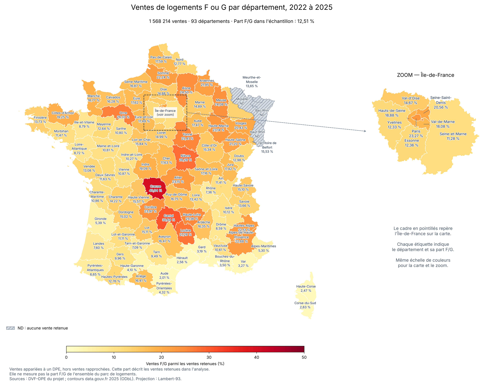
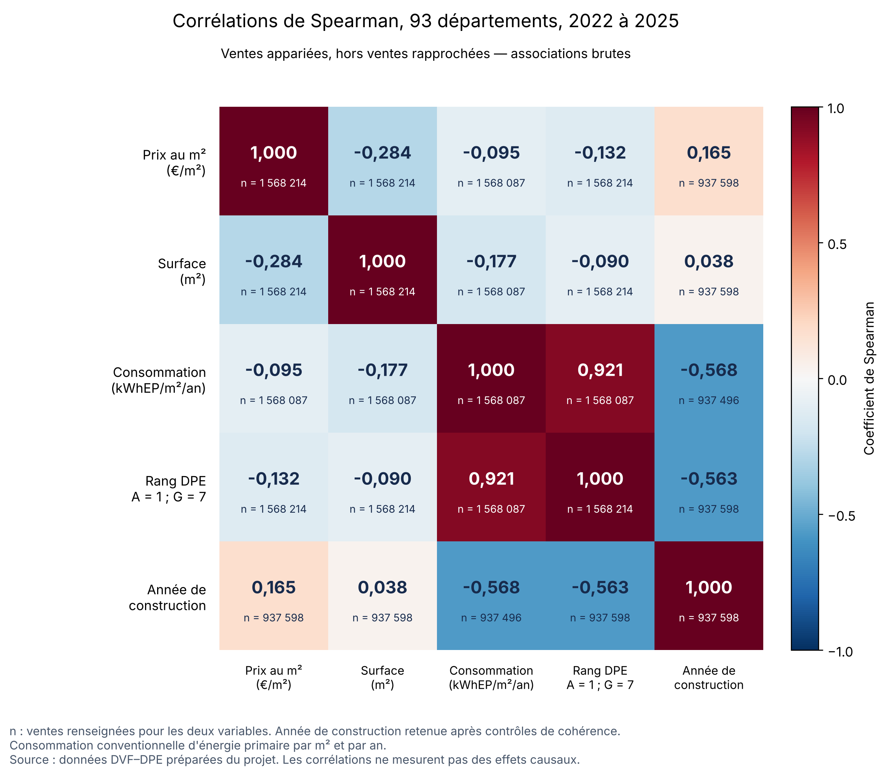
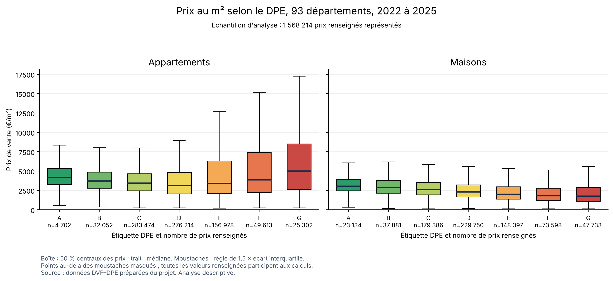

## 2.1 Description par étiquette DPE

L'analyse porte sur 1 568 214 ventes réalisées entre 2022 et 2025 dans 93 départements métropolitains. Nous retenons les ventes appariées à un DPE, après exclusion des ventes rapprochées. Dans les sections 2.1 et 2.2, le prix étudié est toujours le prix de vente au m², exprimé en €/m² ; la surface est exprimée en m². Les résultats décrivent les biens vendus dans cet échantillon et ne peuvent pas être directement étendus à l'ensemble du parc de logements.

**Caractéristiques des biens vendus**

| DPE | Nombre de ventes | Prix moyen (€/m²) | Prix médian (€/m²) | Surface médiane (m²) | Maisons (%) | Construction avant 1975 (%) | Construction ≥ 2013 (%) |
| :-- | --: | --: | --: | --: | --: | --: | --: |
| A | 27 836 | 3 559,76 | 3 203,79 | 104,00 | 83,1 | 6,8 | 77,9 |
| B | 69 933 | 3 563,12 | 3 208,69 | 86,35 | 54,2 | 21,3 | 25,7 |
| C | 462 860 | 3 484,66 | 3 076,92 | 70,94 | 38,8 | 29,9 | 10,0 |
| D | 505 964 | 3 364,08 | 2 684,76 | 75,00 | 45,4 | 61,0 | 0,6 |
| E | 305 375 | 3 536,57 | 2 538,89 | 70,18 | 48,6 | 83,1 | < 0,1 |
| F | 123 211 | 3 378,71 | 2 319,29 | 70,94 | 59,7 | 93,3 | < 0,1 |
| G | 73 035 | 3 498,36 | 2 346,94 | 65,82 | 65,4 | 97,2 | < 0,1 |

*Lecture : les pourcentages sont calculés au sein de chaque étiquette. Les deux dernières colonnes reposent sur les périodes de construction déclarées : « avant 1948 » et « 1948-1974 » pour la première ; « 2013-2021 » et « après 2021 » pour la seconde. La mention « < 0,1 » désigne une part positive inférieure à 0,1 %. Sources : `tables/description_dpe_france.csv` et `tables/construction_dpe_france.csv`. Les arrondis concernent uniquement la présentation.*

Les classes C et D regroupent à elles seules 61,8 % des ventes. Derrière cette répartition, les biens vendus présentent des profils assez différents : les maisons représentent 83,1 % des ventes en A, contre 38,8 % en C. La surface médiane atteint 104 m² en A, contre 65,82 m² en G. Les écarts de prix au m² entre étiquettes s'observent donc entre des groupes dont la composition diffère.

Le contraste apparaît aussi dans les périodes de construction. Parmi les ventes classées A, 77,9 % concernent des biens construits à partir de 2013, d'après la période déclarée. À l'autre extrémité, les constructions antérieures à 1975 représentent 93,3 % des ventes en F et 97,2 % en G. Plus de la moitié des biens vendus en G, soit 54,7 %, datent même d'avant 1948. La répartition détaillée par période est disponible dans le tableau CSV associé. Ces informations restent distinctes de l'année précise de construction, qui n'est pas toujours exploitable pour les corrélations.

**Répartition géographique des ventes de logements F ou G**

La carte rapporte, pour chaque département, le nombre de ventes retenues de logements F ou G au nombre total de ventes retenues. Sur l'ensemble de l'échantillon, ces deux classes représentent 196 246 ventes sur 1 568 214, soit 12,51 %. Cette proportion est calculée à partir des effectifs totaux, sans faire la moyenne simple des pourcentages départementaux.

Les différences géographiques sont marquées. La part F/G atteint 40,04 % dans la Creuse (645 ventes sur 1 611), 30,64 % dans le Cantal (790 sur 2 578) et 28,26 % dans la Nièvre (1 255 sur 4 441). Elle est plus faible dans l'Aude, à 2,01 % (213 sur 10 614), en Haute-Corse, à 2,47 % (30 sur 1 216), et dans l'Hérault, à 2,56 % (1 151 sur 44 989).

La Moselle, le Bas-Rhin et le Haut-Rhin apparaissent en gris car aucune vente de l'échantillon n'y est observée. Il ne faut donc pas lire cette couleur comme une absence de logements F ou G. Les territoires ultramarins ne sont pas représentés sur cette carte métropolitaine. Enfin, les écarts entre départements portent sur les ventes retenues : ils peuvent refléter les caractéristiques des biens vendus et la sélection liée à l'appariement, sans que la carte permette de distinguer ces explications.

*Sources : données DVF–DPE préparées du projet ; fond départemental Etalab, millésime 2025, généralisation 100 m, projection Lambert-93. Calculs et effectifs : `tables/carte_part_fg_france.csv`.*

**Corrélations de Spearman**

La matrice met en relation le prix au m², la surface, la consommation conventionnelle d'énergie primaire par m² et par an, le rang DPE et l'année de construction. L'étiquette est codée de 1 pour A à 7 pour G : plus le rang est élevé, moins le classement énergétique est favorable.

La consommation et le rang DPE sont fortement associés, avec une corrélation de 0,921. L'année de construction est, quant à elle, négativement corrélée à la consommation (−0,568) et au rang DPE (−0,563). Parmi les observations disposant d'une année exploitable, les logements plus récents tendent ainsi à être moins consommateurs et mieux classés.

Les liens avec le prix au m² sont moins prononcés. Sa corrélation est de −0,132 avec le rang DPE et de −0,095 avec la consommation. Elle atteint −0,284 avec la surface et +0,165 avec l'année de construction. Ces coefficients décrivent des associations entre les rangs des observations ; ils ne s'interprètent ni comme des variations de prix en pourcentage, ni comme des effets causaux.

Les effectifs varient selon les variables disponibles. Les corrélations entre prix au m², surface et rang DPE reposent sur 1 568 214 ventes, contre 1 568 087 lorsque la consommation intervient. Chaque calcul utilise uniquement les ventes renseignées pour les deux variables concernées.

Pour l'année de construction, 598 081 valeurs sont absentes ou non numériques et 32 535 années renseignées sont écartées après vérification. Une année est retenue si elle est entière, positive, non postérieure à la vente et compatible avec la période de construction déclarée. Il reste 937 598 années exploitables, dont 937 496 avec une consommation renseignée. Aucune année n'est imputée. Les ventes concernées restent utilisées pour les autres corrélations lorsque leurs données le permettent. Les résultats faisant intervenir l'année doivent donc être lus en gardant à l'esprit qu'ils portent sur un sous-échantillon.

*Sources : `tables/correlations_spearman_france.csv`, `tables/effectifs_correlations_france.csv` et `tables/controle_annee_construction_france.csv`.*

## 2.2 Comparaison brute des prix au m²

Pour examiner les écarts de prix au m² entre étiquettes, nous distinguons les maisons des appartements. Les boîtes à moustaches présentent les distributions de chaque groupe sur une même échelle verticale, ce qui permet de comparer à la fois leurs médianes et leur dispersion.

Chaque boîte contient les 50 % centraux des prix au m², et le trait intérieur indique la médiane. Les moustaches s'étendent jusqu'aux valeurs observées dans la limite de 1,5 fois l'écart interquartile en dessous du premier quartile et au-dessus du troisième. Les points situés au-delà sont masqués pour faciliter la lecture, mais toutes les valeurs renseignées restent incluses dans les calculs.

| DPE | Prix médian des appartements (€/m²) | Prix médian des maisons (€/m²) |
| :-- | --: | --: |
| A | 4 169,63 | 3 055,68 |
| B | 3 716,41 | 2 845,36 |
| C | 3 427,36 | 2 622,47 |
| D | 3 125,28 | 2 313,73 |
| E | 3 394,68 | 2 010,87 |
| F | 3 869,23 | 1 810,34 |
| G | 4 998,09 | 1 760,00 |

*Source : `tables/description_type_dpe_france.csv`. Les effectifs de chaque groupe sont indiqués sur le graphique.*

Pour les maisons, le prix médian au m² diminue à mesure que l'on passe de A à G : il va de 3 055,68 à 1 760,00 €/m². La médiane en G est ainsi inférieure de 42,4 % à celle de A. Les distributions se recouvrent néanmoins largement : l'étiquette seule ne suffit pas à caractériser le prix au m² d'une vente.

Le profil des appartements est différent. Leur prix médian au m² baisse de A à D, puis remonte de E à G. Il atteint 4 998,09 €/m² en G, soit 19,9 % de plus qu'en A. Cette comparaison concerne toutefois des biens de tailles différentes : la surface médiane des appartements G est d'environ 34,2 m², contre 61,2 m² en A. La hausse observée pour les classes les moins favorables ne permet donc pas de conclure qu'un mauvais DPE augmenterait le prix d'un appartement.

Les deux écarts entre G et A sont calculés à partir des médianes non arrondies, selon la formule `100 × (médiane G / médiane A − 1)`, séparément pour chaque type de bien. Ils restent des écarts bruts entre groupes. Même après avoir séparé maisons et appartements, des différences de localisation, de surface, de période de construction et de date de vente subsistent. La section 2.3 prolonge cette analyse en comparant des logements semblables.

**Traçabilité des résultats**

Les tableaux et figures proviennent des sorties de `notebooks/karlane_description_france.ipynb`. Les CSV conservent la précision des calculs ; seuls les nombres présentés ici sont arrondis. Si les données ou les règles de sélection changent, il faudra régénérer ces sorties et actualiser le texte. La validation finale de la reproductibilité prévoit une exécution complète du notebook après redémarrage du noyau.
